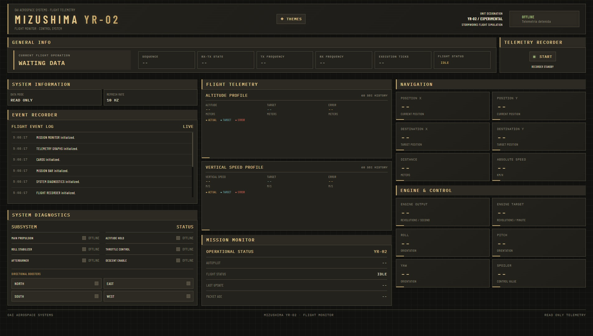

# OAi Electronics — Telemetry Monitor

<p align="center">
  
</p>

A modular and configurable telemetry dashboard designed to monitor vehicle systems and visualize real-time vehicle data.

The project provides a flexible monitoring interface where both the dashboard layout and its appearance can be customized without modifying the core application.

## Key Features

- **JSON-based configuration:** Customize dashboard modules, cards, sections, and data sources without editing HTML or JavaScript.
- **Fully modular layout:** Enable, disable, rearrange, and configure modules, including the number of dashboard columns.
- **Theme selection:** Switch between multiple built-in visual themes.
- **Custom themes:** Create and integrate your own themes using CSS and optional JavaScript, without modifying the core system.
- **Telemetry monitoring:** Receive and visualize live vehicle data through an HTTP endpoint.
- **Recording and diagnostics:** Includes vehicle data recording, system diagnostics, event monitoring, and telemetry graphs.

## Technology Stack

- **Backend:** Python 3.12, Flask
- **Frontend:** HTML5, CSS3, JavaScript (ES Modules)
- **Configuration:** JSON
- **Deployment:** Docker and Docker Compose

## Getting Started

### Requirements

- Docker
- Docker Compose

### Run with Docker

Clone the repository:

```bash
git clone https://github.com/YOUR_USERNAME/YOUR_REPOSITORY.git
cd YOUR_REPOSITORY
```

Build and start the application:

```bash
docker compose up -d --build
```

### Access the Dashboard

Once the container is running, open:

```text
http://localhost:8080
```

To access the dashboard from another device on the same network, use the IP address of the computer running Docker:

```text
http://YOUR_HOST_IP:8080
```

### Connect a Telemetry Source

The monitor listens for incoming vehicle telemetry on:

```text
http://YOUR_HOST_IP:8080/telemetry
```

Send telemetry data using HTTP GET requests with the supported parameters.

Make sure the sending device can reach the host computer over the network and that port `8080` is accessible through its firewall.

## Documentation

Additional documentation and examples are available in the repository:

- [Configuration Guide](telemetry-monitor/app/config/README.md) — JSON configuration files and dashboard customization.
- [Themes Guide](telemetry-monitor/app/static/modularStylesheet/README.md) — Built-in themes and how to create your own.
- [Stormworks Lua Example](LUA%20code%20expample/README.md) — Example telemetry integration using Stormworks Lua.

## Custom Themes

Themes are located in:

```text
app/static/modularStylesheet/themes/
```

You can create your own CSS theme and optionally attach JavaScript scripts for additional visual effects or behavior. Register your theme in the themes configuration to make it available in the dashboard selector.

---

**OAi Electronics — Modular telemetry monitoring, built for customization.**